# Диаграмма компонентов

Компоненты системы и их связи. Узлы сгруппированы по слоям
(см. [system-overview.md](system-overview.md)). Пунктир — асинхронные/внешние
вызовы; сплошные линии — синхронные зависимости внутри процесса.

```mermaid
graph TB
    FE["Frontend (MapLibre / GIS UI)"]

    subgraph API["API-слой (FastAPI, app/api)"]
        ROUTERS["v1 routers: auth, uploads, jobs, assets,<br/>observations, defects, reviews, map,<br/>routes, analytics, exports, ml, files"]
        SCHEMAS["Pydantic schemas (app/schemas)"]
        SER["serializers.py (ORM to DTO)"]
        DEP["dependencies.py (DI, JWT, RBAC)"]
        HEALTH["health.py / metrics endpoint"]
    end

    subgraph APP["Application-слой (app/application)"]
        UPS["UploadService"]
        JOBS["JobService"]
        ASS["AssetService"]
        REV["ReviewService"]
        DED["DeduplicationService"]
        GEO["GeolocationService"]
        GSP["GeospatialService"]
        HIS["AssetHistoryService"]
        RISK["RiskScoringService"]
        ANA["AnalyticsService"]
        EXP["ExportService"]
        IDEM["IdempotencyService"]
        AUTH["AuthService"]
        PIPE["ProcessingPipeline (use_cases/processing)"]
        QG["QualityGate"]
        PF["PrivacyFilter"]
        FR["frames.py (OpenCV)"]
        IFACE["Interfaces: MLProvider, ObjectStorage, JobQueue"]
    end

    subgraph DOM["Domain-слой (app/domain, без I/O)"]
        ENUM["enums.py"]
        TAXA["assets/defects taxonomy"]
        DPOL["deduplication/policy.py"]
        RSCORE["risk/scoring.py"]
        SM["processing/state_machine.py"]
        RLOG["reviews/logic.py"]
        COND["observations/condition.py"]
        GMOD["geospatial/models.py"]
    end

    subgraph INFRA["Infrastructure-слой (app/infrastructure)"]
        REPOS["Repositories (app/infrastructure/database/repositories)"]
        MODELS["ORM models (database/models)"]
        SESS["Database session (asyncpg)"]
        MLF["ml/factory.py"]
        MOCK["MockMLProvider"]
        HTTP["HTTPMLProvider"]
        QF["queue/factory.py"]
        RQQ["RQJobQueue"]
        INL["InlineJobQueue"]
        SF["storage/factory.py"]
        S3C["S3Storage (boto3)"]
        LOC["LocalFilesystemStorage"]
    end

    subgraph WORKER["Worker (app/workers)"]
        WENTRY["worker.py (RQ Worker)"]
        WTASK["tasks/processing.py"]
    end

    subgraph EXT["Внешние сервисы (docker-compose)"]
        PG[("PostgreSQL 16 + PostGIS 3.4")]
        REDIS[("Redis 7")]
        S3[("SeaweedFS (S3 API)")]
        MLSVC["External ML service (HTTP, contract 1.0)"]
    end

    FE -->|HTTPS /api/v1| ROUTERS
    ROUTERS --> SCHEMAS
    ROUTERS --> SER
    ROUTERS --> DEP
    ROUTERS --> UPS
    ROUTERS --> JOBS
    ROUTERS --> ASS
    ROUTERS --> REV
    ROUTERS --> GSP
    ROUTERS --> ANA
    ROUTERS --> EXP
    ROUTERS --> AUTH
    ROUTERS --> IDEM
    SER --> MODELS

    UPS --> IFACE
    JOBS --> IFACE
    ASS --> RISK
    ASS --> HIS
    REV --> RISK
    REV --> HIS
    REV --> RLOG
    DED --> DPOL
    DED --> REPOS
    GEO --> GMOD
    GSP --> REPOS
    HIS --> REPOS
    RISK --> RSCORE
    ANA --> REPOS
    EXP --> REPOS
    AUTH --> REPOS

    PIPE --> QG
    PIPE --> PF
    PIPE --> FR
    PIPE --> DED
    PIPE --> GEO
    PIPE --> RISK
    PIPE --> HIS
    PIPE --> IFACE
    PIPE --> REPOS
    PIPE --> SM
    PIPE --> COND

    DPOL --> ENUM
    RSCORE --> TAXA
    RSCORE --> ENUM
    RLOG --> COND
    SM --> ENUM
    GMOD --> ENUM

    REPOS --> MODELS
    REPOS --> SESS
    SESS --> PG
    MLF --> MOCK
    MLF --> HTTP
    QF --> RQQ
    QF --> INL
    SF --> S3C
    SF --> LOC
    IFACE -.-> MLF
    IFACE -.-> QF
    IFACE -.-> SF

    RQQ --> REDIS
    S3C --> S3
    LOC --> S3
    HTTP -.->|POST /v1/infer| MLSVC

    JOBS -->|enqueue| RQQ
    REDIS -->|dequeue| WENTRY
    WENTRY --> WTASK
    WTASK --> PIPE
    INL -.->|in-process| PIPE
    HEALTH --> SESS
    HEALTH --> REDIS
```

## Легенда

| Элемент | Значение |
|---------|----------|
| `FE` | Frontend (вне backend-репозитория); общается по HTTPS с `/api/v1`, использует GeoJSON-слои и presigned-URL |
| **API-слой** | Тонкие роутеры, Pydantic-схемы, сериализация ORM→DTO, DI/JWT/RBAC, health/metrics |
| **Application-слой** | Сервисы сценариев и `ProcessingPipeline`; зависит от Protocols-интерфейсов |
| **Domain-слой** | Чистая логика без I/O: enums, таксономии, политики, state machine |
| **Infrastructure-слой** | Репозитории/ORM, фабрики и реализации ML/очереди/хранилища |
| **Worker** | Отдельный процесс RQ; исполняет pipeline вне HTTP-запроса |
| `PG` | PostgreSQL 16 + PostGIS 3.4 (`postgis/postgis:16-3.4`) — данные и гео-запросы |
| `REDIS` | Redis 7 (`redis:7-alpine`) — очередь RQ, rate limit |
| `S3` | SeaweedFS за S3 API (`chrislusf/seaweedfs`) — бинарные файлы; выбор вместо MinIO см. ADR-0006 |
| `MLSVC` | Внешний ML-сервис (опционально, `ML_PROVIDER=http`); по умолчанию `MockMLProvider` |
| Сплошная стрелка | Синхронная зависимость/вызов внутри процесса |
| Пунктирная стрелка | Асинхронный, внешний или опциональный вызов (очередь, HTTP ML, inline-режим) |

## Пояснения к ключевым связям

- **API не импортирует код воркера.** `RQJobQueue` ставит задачу по import-path
  (`app.workers.tasks.processing.process_upload_task`); воркер сам строит
  `Database`, `ObjectStorage`, `MLProvider` на каждое выполнение.
- **Domain изолирован.** `DeduplicationService` (application) ходит в PostGIS за
  кандидатами и передаёт «свидетельства» в `deduplication/policy.py` (domain),
  который не имеет I/O.
- **Inline-режим** (`QUEUE_MODE=inline`) исполняет pipeline в процессе API —
  только для тестов/dev, не для production.
- **ORM не покидает API-слой:** сериализаторы конвертируют модели в Pydantic-DTO,
  добавляя lon/lat и presigned-URL.

## Связанные документы
- [Обзор системы](system-overview.md) · [Поток данных](data-flow.md) ·
  [Sequence-диаграммы](sequence-diagrams.md)
