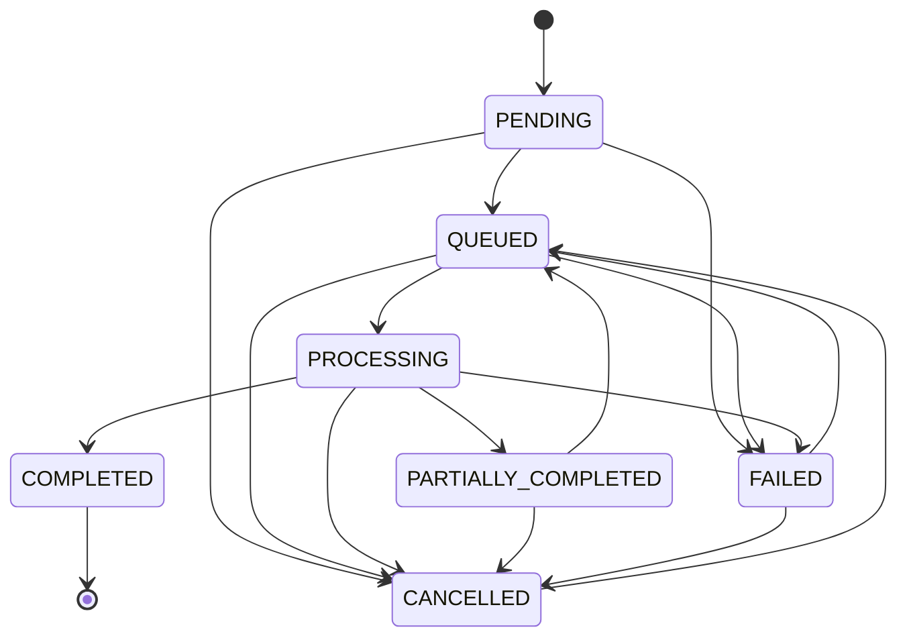

# Доменная модель

Сущности persistence описаны в `backend/app/infrastructure/database/models/*.py`,
перечисления — в `backend/app/domain/enums.py`, чистая бизнес-логика — в
`backend/app/domain/*`. Ниже — назначение, ключевые поля, связи и инварианты
каждой сущности. Полная схема колонок и constraints — в [schema.md](../database/schema.md).

## Ключевое разделение: Asset ≠ Observation ≠ Defect

Это центральное архитектурное решение модели:

- **Asset** (`models/asset.py`) — **физический объект** со стабильной идентичностью
  между съёмками (колодец, опора, шкаф). Имеет текущее состояние и приоритет.
  Создаётся дедупликацией (`NEW_ASSET`) или переиспользуется (`MATCHED`).
- **Observation** (`models/observation.py`) — **одна детекция** объекта на конкретном
  кадре конкретным ML-прогоном. Хранится **независимо от подтверждения человеком**.
  Оригинальный вывод ML **иммутабелен** (`raw_model_payload`, `condition_class`,
  `detector_confidence`, `severity`); человеческие корректировки живут в
  `reviews` + полях `effective_*`. Observation может быть без `asset_id`
  (`POSSIBLE_MATCH`/`AMBIGUOUS` dedup, либо отсутствие геолокации и tracking).
- **Defect** (`models/defect.py`) — **конкретная проблема** актива, подтверждённая
  ≥1 наблюдением. Агрегирует наблюдения через `defect_observations`, имеет
  собственный lifecycle (`OPEN→CONFIRMED→IN_PROGRESS→RESOLVED/REJECTED`).

Зачем: один актив наблюдается многократно (история, change detection), одна
проблема может подтверждаться разными наблюдениями, а сырой ML-вывод никогда
не затирается review — это обеспечивает аудируемость и active learning.

## Разделение: confidence ≠ severity ≠ priority

Три **независимые** величины, которые нельзя смешивать:

| Величина | Смысл | Диапазон | Источник |
|----------|-------|----------|----------|
| **confidence** | уверенность ML-детектора в детекции | `[0, 1]` | `Observation.detector_confidence` (от ML) |
| **severity** | тяжесть дефекта/состояния объекта | `1..5` (или NULL) | ML или `default_severity_for_condition`, корректируется review |
| **priority** | вычисленный приоритет вмешательства | `[0, 100]` | `domain/risk/scoring.py`, производная от severity × impact × confidence |

- Низкая confidence **не доказывает** отсутствие проблемы: она умеренно снижает
  priority (`confidence_factor = 0.5 + 0.5*confidence`) и может направить актив
  в `NEEDS_REVIEW`, а не молча занизить приоритет.
- `severity=NULL` (неизвестна) нормализуется в `0.5` при расчёте, но помечает
  актив как требующий review.
- priority — **эвристика проекта**, не отраслевой стандарт; версионируется
  (`priority_policy_version`, по умолчанию `1.0`).

## Сущности

### Asset — `assets`
- **Назначение:** реестр физических объектов инфраструктуры.
- **Ключевые поля:** `asset_type` (VARCHAR, валидируется таксономией),
  `external_id` (unique, nullable), `display_name`, `location` (Geography POINT 4326),
  `location_accuracy_m`, `geolocation_status`, `current_condition`, `current_severity`,
  `current_priority`, `priority_band`, `priority_factors` (JSONB), `priority_policy_version`,
  `priority_override` + `priority_override_reason`, `lifecycle_status`,
  `first_observed_at`, `last_observed_at`, `version` (optimistic locking).
- **Связи:** `observations` (1→N, SET NULL), `defects` (1→N, CASCADE).
- **Инварианты (CHECK):**
  - `current_severity` NULL или `1..5`;
  - `current_priority` / `priority_override` NULL или `0..100`;
  - `location_matches_status`: `(location IS NULL) = (geolocation_status IN ('UNAVAILABLE','INVALID'))`.
- **Поведение:** location обновляется только если «улучшается»
  (`pipeline.py::_location_improves`: ранг CONFIRMED>ESTIMATED>UNAVAILABLE>INVALID,
  затем меньшая accuracy). PATCH — optimistic locking по `version`
  (`services/assets.py`, `repositories/assets.py::update_with_version`).

### Observation — `observations`
- **Назначение:** единичная ML-детекция на кадре; иммутабельный оригинал + effective-состояние.
- **Ключевые поля:** `asset_id` (nullable FK), `processing_job_id` (FK CASCADE),
  `job_frame_id` (nullable), `frame_id`, `detection_id` (UUID от ML), `observed_at`,
  `detected_at`, `object_type`, `condition_class`, `detector_confidence`,
  `classifier_confidence`, `severity`, `bbox` (JSONB, пиксели), `image_width/height`,
  `image_id`/`crop_image_id` (FK stored_files), `location` (Geography POINT),
  `geolocation_status`/`geolocation_source`, `heading_deg`, `speed_mps`, `tracking_id`,
  `model_name`/`model_version`, `raw_model_payload` (JSONB), `dedup_result`/`dedup_score`/
  `dedup_explanation` (JSONB), `review_status`, `effective_asset_type`/`effective_condition`/
  `effective_severity`.
- **Связи:** asset (N→1), job (N→1), job_frame, image/crop (stored_files), defects (M→N).
- **Инварианты:** confidence `[0,1]`; severity NULL или `1..5`; `location_matches_status`;
  partial UNIQUE(`processing_job_id`, `detection_id`) WHERE `detection_id IS NOT NULL`.
- **review_status:** `UNREVIEWED` (default) → `CONFIRMED/REJECTED/CORRECTED/NEEDS_MORE_INFORMATION`.

### Defect — `defects`
- **Назначение:** конкретная проблема актива, подтверждённая наблюдениями.
- **Ключевые поля:** `asset_id` (FK CASCADE), `defect_type` (VARCHAR, таксономия),
  `description`, `severity` (`1..5`, NOT NULL), `status`, `first_detected_at`,
  `last_detected_at`, `resolved_at`.
- **Связи:** asset (N→1), observations (M→N через `defect_observations`).
- **Инварианты:** `severity 1..5`. Upsert по `find_open_by_type`: повторное наблюдение
  обновляет `last_detected_at` и `severity = max(...)` (`pipeline.py::_upsert_defect`).
- **status:** `OPEN` (default) → `CONFIRMED` → `IN_PROGRESS` → `RESOLVED` / `REJECTED`.
  `REJECTED` нельзя перевести в `RESOLVED` без review (`api/v1/defects.py`).

### Review — `reviews`
- **Назначение:** **append-only** действие оператора; история не перезаписывается.
- **Ключевые поля:** `observation_id` (nullable FK), `defect_id` (nullable FK),
  `reviewer_id` (FK users RESTRICT), `decision`, `corrected_asset_type`/`corrected_condition`/
  `corrected_defect_type`/`corrected_severity`, `comment`, `reviewed_at`.
- **Инварианты:** `review_target_present` (observation_id или defect_id NOT NULL);
  `corrected_severity` NULL или `1..5`.
- **decision:** `CONFIRMED`, `REJECTED`, `CORRECTED`, `NEEDS_MORE_INFORMATION`.
- **Логика (`domain/reviews/logic.py`):** `CORRECTED` обязан содержать ≥1 корректировку;
  корректировки допустимы только с `CORRECTED`. Последнее review определяет
  effective-состояние наблюдения; оригинал ML не меняется.
- **Эффекты (`services/reviews.py`):** обновляет `observation.review_status` и `effective_*`;
  `CONFIRMED/CORRECTED` → upsert `TrainingExample`; пересчитывает risk актива;
  пишет `AssetConditionHistory(source=HUMAN_REVIEW)`; применяет к дефекту
  (REJECTED → статус REJECTED, если это единственное наблюдение; CONFIRMED → CONFIRMED;
  CORRECTED → тип/severity).

### ProcessingJob — `processing_jobs`
- **Назначение:** задание на обработку upload; источник прогресса и статуса.
- **Ключевые поля:** `upload_id` (FK CASCADE), `route_id` (nullable FK SET NULL),
  `status`, `progress` (`0..1`), `current_stage`, `total_frames`/`processed_frames`/
  `failed_frames`/`rejected_frames`, `started_at`/`finished_at`, `error_code`/`error_message`,
  `idempotency_key` (unique), `rq_job_id`, `options` (JSONB).
- **Связи:** upload (N→1), route (N→1), frames (1→N, delete-orphan).
- **Инварианты:** `progress 0..1`; счётчики кадров ≥0.
- **State machine:** см. ниже.

### JobFrame — `job_frames`
- **Назначение:** покадровая запись обработки; **якорь идемпотентности** и источник прогресса.
- **Ключевые поля:** `job_id` (FK CASCADE), `frame_index`, `stored_file_id` (nullable FK),
  `status`, `reject_reason`, `error_code`, `observed_at`.
- **Инварианты:** UNIQUE(`job_id`, `frame_index`) — `uq_job_frame_index`.
- **status:** `PROCESSED`, `REJECTED`, `FAILED`, `SKIPPED`.

### Upload — `uploads`
- **Назначение:** загруженный оригинальный файл (фото/видео) + метаданные съёмки.
- **Ключевые поля:** `original_filename`, `storage_key` (unique), `content_type`,
  `file_size` (BigInteger), `checksum_sha256` (unique), `media_type`, `uploaded_by`
  (nullable FK users), `route_id` (nullable FK routes), `metadata` (JSONB, вкл. `gps_track`,
  `capture_started_at`).
- **Связи:** route, uploader (user), jobs (1→N).
- **Инварианты:** уникальность `storage_key` и `checksum_sha256` (дедупликация загрузок).
- **Удаление:** запрещено при наличии jobs (`ConflictError`, `services/uploads.py`).

### StoredFile — `stored_files`
- **Назначение:** метаданные файла в объектном хранилище. **Бинарник не в PostgreSQL.**
- **Ключевые поля:** `storage_key` (unique), `kind`, `upload_id` (nullable FK CASCADE),
  `content_type`, `file_size`, `checksum_sha256` (nullable), `width`/`height`,
  `anonymization_status`, `metadata` (JSONB).
- **kind:** `ORIGINAL`, `FRAME`, `CROP`, `ANONYMIZED`, `EXPORT`.
- **anonymization_status:** `NOT_APPLIED` (default), `APPLIED`, `FAILED`, `SKIPPED`.

### Route — `routes`
- **Назначение:** маршрут съёмки (проезд автомобиля).
- **Ключевые поля:** `name`, `vehicle_id`, `started_at`/`finished_at`,
  `track_geometry` (Geography LINESTRING 4326), `total_distance_m` (через `ST_Length`),
  `metadata` (JSONB).
- **Связи:** uploads (1→N), jobs (1→N).

### User — `users`
- **Назначение:** учётная запись; RBAC.
- **Ключевые поля:** `username` (unique), `email` (unique, nullable), `password_hash`
  (Argon2id), `role`, `is_active`.
- **role:** `ADMIN`, `OPERATOR`, `VIEWER`, `SERVICE`.
- **Поведение:** bootstrap первого admin при пустой БД и заданном пароле
  (`services/auth.py::bootstrap_admin`).

### AuditLog — `audit_logs`
- **Назначение:** **append-only** аудит действий. В приложении нет путей update/delete.
- **Ключевые поля:** `actor_id` (nullable FK users SET NULL), `action`, `entity_type`,
  `entity_id`, `before_state`/`after_state` (JSONB), `request_id`.
- **action (enum `AuditAction`):** `CREATE`, `UPDATE`, `DELETE`, `REVIEW`, `LOGIN`,
  `EXPORT`, `JOB_RETRY`, `JOB_CANCEL`. (Колонка `action` — VARCHAR(32), не native enum.)

### TrainingExample — `training_examples`
- **Назначение:** проверенная пара (image, label) для **контролируемого** active learning.
- **Ключевые поля:** `observation_id` (unique FK CASCADE), `review_id` (FK CASCADE),
  `image_storage_key`, `label` (JSONB), `status`, `exported_at`.
- **Инварианты:** один observation → один example (unique). Upsert при повторном review.
- **status:** `PENDING` (default), `EXPORTED`. Авто-дообучения нет — только сбор/экспорт.

### AssetConditionHistory — `asset_condition_history`
- **Назначение:** изменение состояния актива с явным источником; change detection.
- **Ключевые поля:** `asset_id` (FK CASCADE), `observation_id`/`review_id` (nullable FK SET NULL),
  `change_source`, `previous_condition`/`new_condition`, `previous_severity`/`new_severity`,
  `previous_priority`/`new_priority`, `is_physical_change`, `note`, `detected_at`.
- **change_source:** `ML_PREDICTION`, `HUMAN_REVIEW`, `MANUAL_EDIT`, `SYSTEM`.
- **Инвариант смысла:** `is_physical_change=False` помечает колебания ML-предсказаний,
  **не** подтверждённые физические изменения. `True` — для человеческих источников
  или когда observation уже human-verified (`services/history.py`).

### IdempotencyRecord — `idempotency_keys`
- **Назначение:** кэш ответов unsafe POST для replay по `Idempotency-Key`.
- **Ключевые поля:** `key`, `user_id` (FK CASCADE), `endpoint`, `response_status`,
  `response_body` (JSONB).
- **Инварианты:** UNIQUE(`key`, `user_id`, `endpoint`) — `uq_idempotency_scope`.

### Ассоциативная таблица defect_observations
- M→N между `defects` и `observations`; составной PK(`defect_id`, `observation_id`),
  оба FK CASCADE. Подробности — в [schema.md](../database/schema.md).

## Статусы геолокации

`GeolocationStatus` (`domain/enums.py`, `services/geolocation.py`):

| Статус | Смысл | Точка |
|--------|-------|-------|
| `CONFIRMED` | GPS-точка с зазором ≤2 c | обязательна |
| `ESTIMATED` | интерполяция GPS, зазор ≤10 c | обязательна |
| `UNAVAILABLE` | трека нет / зазор >10 c | **отсутствует** |
| `INVALID` | координаты невалидны | **отсутствует** |

`GeolocationSource`: `GPS`, `MANUAL`, `MAP_MATCHING`, `VISUAL`, `UNKNOWN`.
В MVP фактически используется `GPS` (и `UNKNOWN` при отсутствии). `MANUAL` —
при ручном PATCH location (`services/assets.py` ставит CONFIRMED). `MAP_MATCHING`/
`VISUAL` — зарезервированы для будущих расширений.

Инвариант (CHECK `location_matches_status` на assets и observations):
`(location IS NULL) = (geolocation_status IN ('UNAVAILABLE','INVALID'))`.
Координаты **никогда не выдумываются**.

## Результаты дедупликации

`DeduplicationResult` (`domain/deduplication/policy.py`):

| Результат | Условие | Действие |
|-----------|---------|----------|
| `MATCHED` | score ≥ match_threshold (0.70), единственный сильный кандидат | привязка observation к существующему активу |
| `NEW_ASSET` | нет кандидатов / score < possible_threshold (0.45) | создание нового актива |
| `POSSIBLE_MATCH` | possible_threshold ≤ score < match_threshold | observation **без** asset_id (кандидат в `dedup_explanation`), флаг для review |
| `AMBIGUOUS` | ≥2 сильных кандидата, разница <0.10 | **без авто-слияния**, observation без asset_id, review |

Каждое решение несёт машиночитаемый `explanation` (policy `weighted-v1`, веса,
config, best_factors, top-5 кандидатов), сохраняемый в `Observation.dedup_explanation`.

> Примечание о порогах: dataclass `DeduplicationConfig` имеет default
> `match_threshold=0.75`, но `DeduplicationService` строит config из `Settings`,
> где `dedup_match_threshold=0.70`. **Эффективный порог в рантайме — 0.70.**

## Review decisions (append-only)

`ReviewDecision`: `CONFIRMED`, `REJECTED`, `CORRECTED`, `NEEDS_MORE_INFORMATION`.
Новое review **никогда** не мутирует предыдущие; последнее определяет effective-состояние.
Оригинальные ML-предсказания сохраняются нетронутыми. См. `domain/reviews/logic.py`
(`validate_review`, `apply_review`) и `services/reviews.py`.

## State machines

### ProcessingJob (`domain/processing/state_machine.py`)

- `RETRYABLE_STATUSES`: `FAILED`, `PARTIALLY_COMPLETED`, `CANCELLED` (→ `QUEUED`).
- `CANCELLABLE_STATUSES`: `PENDING`, `QUEUED`, `PROCESSING` (→ `CANCELLED`).
- `TERMINAL_STATUSES`: `COMPLETED` (переходов нет).
- Переходы валидируются `assert_transition`; недопустимый → `InvalidTransitionError`
  (в API → `JobStateError`, HTTP 409).

### LifecycleStatus актива
`ACTIVE` (default), `INACTIVE`, `RETIRED`, `UNKNOWN`. Меняется ручным PATCH
(`services/assets.py`); дедупликация рассматривает только `ACTIVE` активы.
Отдельной state-machine для lifecycle в коде нет — допустимые значения ограничены enum.

### DefectStatus
`OPEN` (default) → `CONFIRMED` → `IN_PROGRESS` → `RESOLVED` / `REJECTED`.
Переходы выполняются review (`services/reviews.py`) и PATCH (`api/v1/defects.py`);
`REJECTED → RESOLVED` запрещён без review. Формальной state-machine нет.

### ObservationReviewStatus
`UNREVIEWED` (default) → `CONFIRMED` / `REJECTED` / `CORRECTED` / `NEEDS_MORE_INFORMATION`
(маппинг из `ReviewDecision` в `services/reviews.py::_DECISION_TO_STATUS`).

### TrainingExampleStatus
`PENDING` (default) → `EXPORTED` (при экспорте; `exported_at`).

## Связанные документы
- [Обзор системы](system-overview.md) · [Поток данных](data-flow.md) ·
  [Схема БД](../database/schema.md) · [Геопространственный слой](../database/geospatial.md)
