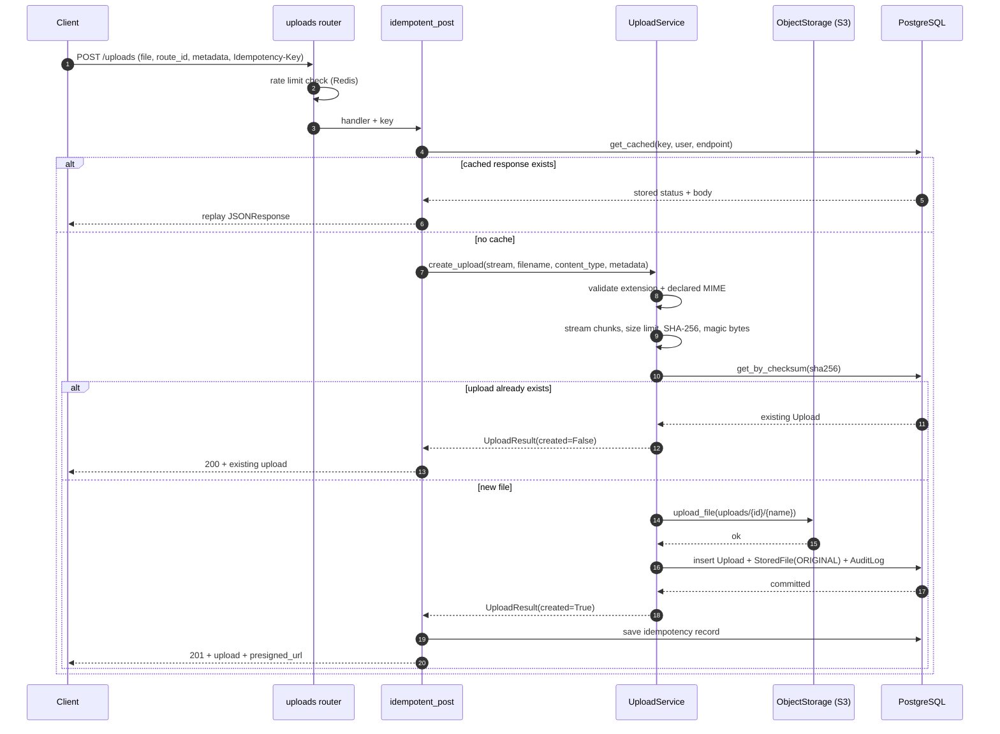
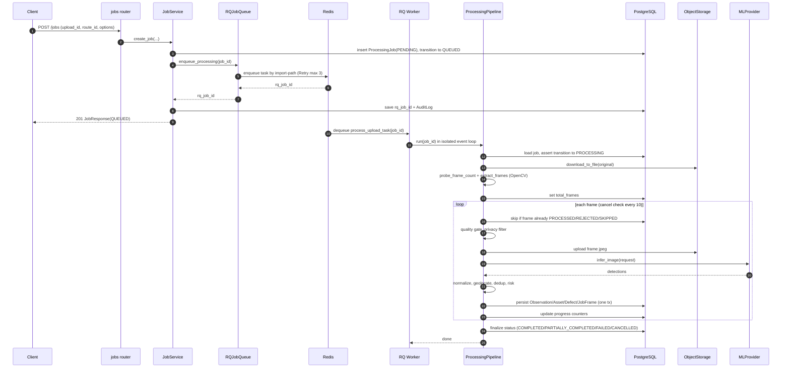
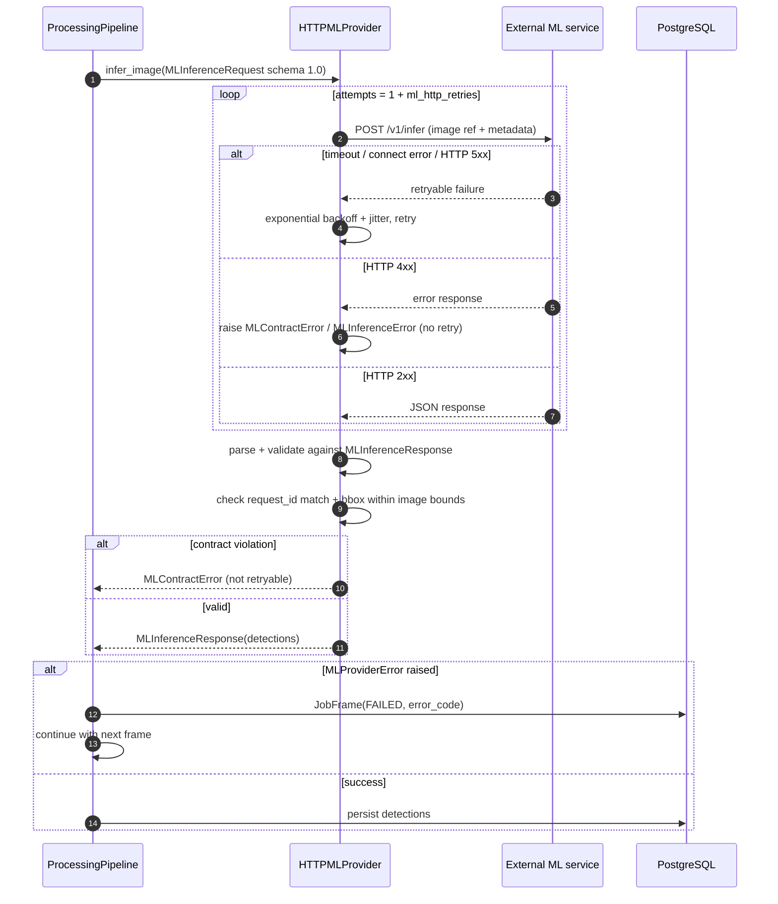
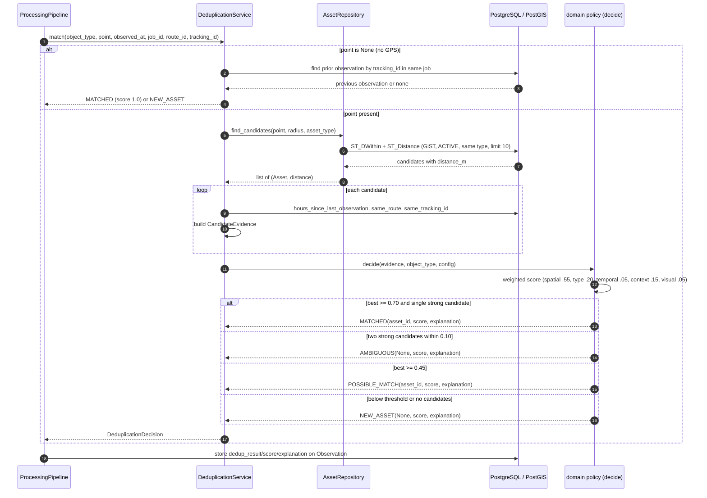
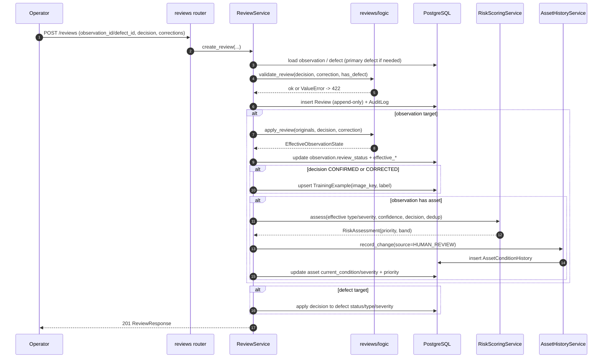
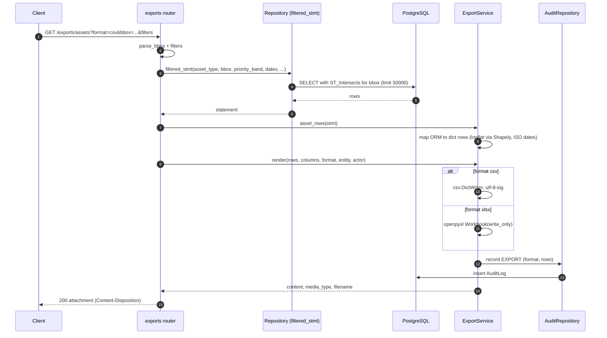

# Sequence-диаграммы ключевых сценариев

Диаграммы отражают фактический поток вызовов в коде. Имена участников сокращены;
соответствие реальным модулям дано в подписях и в [component-diagram.md](component-diagram.md).

## 1. Upload (multipart → валидация → checksum-дедуп → S3 → БД)

Код: `api/v1/uploads.py`, `api/v1/idempotency.py`, `services/uploads.py`,
`infrastructure/storage/s3.py`.

## 2. Processing (API → RQ → worker → pipeline → БД)

Код: `api/v1/jobs.py`, `services/jobs.py`, `infrastructure/queue/rq_queue.py`,
`workers/worker.py`, `workers/tasks/processing.py`, `use_cases/processing/pipeline.py`.

## 3. Inference (pipeline → MLProvider → валидация контракта → retries)

Код: `use_cases/processing/pipeline.py::_process_frame`,
`infrastructure/ml/http_provider.py`, `schemas/ml.py`, `core/exceptions.py`.

## 4. Deduplication (PostGIS-кандидаты → политика → решение → explanation)

Код: `services/deduplication.py`, `repositories/assets.py::find_candidates`,
`domain/deduplication/policy.py`.

> Ветви `alt/else` взаимоисключающие: политика выбирает ровно один результат.

## 5. Review (оператор → ReviewService → observation/defect/asset/training/history)

Код: `api/v1/reviews.py`, `services/reviews.py`, `domain/reviews/logic.py`,
`services/risk.py`, `services/history.py`.

## 6. Export (фильтры → строки → CSV/XLSX)

Код: `api/v1/exports.py`, `services/exports.py`, репозитории, `openpyxl`/`csv`.

## Связанные документы
- [Обзор системы](system-overview.md) · [Поток данных](data-flow.md) ·
  [Диаграмма компонентов](component-diagram.md) · [Доменная модель](domain-model.md)
