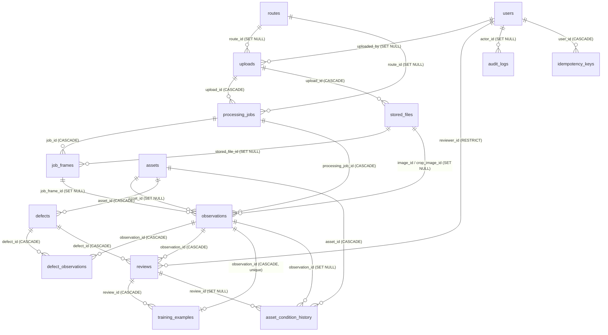

# Схема базы данных

СУБД: **PostgreSQL 16 + PostGIS 3.4** (образ `postgis/postgis:16-3.4`).
Источник истины — миграция `backend/migrations/versions/0001_initial.py`
(revision `0001_initial`); ORM-модели — `backend/app/infrastructure/database/models/*.py`.

Схема содержит **15 прикладных таблиц** (14 сущностей + ассоциативная
`defect_observations`) и служебную `alembic_version`. Расширение `postgis`
создаётся миграцией (`CREATE EXTENSION IF NOT EXISTS postgis`).

Общие соглашения:
- PK всех сущностей — `id UUID` (генерация `uuid.uuid4` на стороне приложения, `UUIDPrimaryKeyMixin`).
- `created_at TIMESTAMPTZ NOT NULL DEFAULT now()` (индексируется) — `CreatedAtMixin`.
- `updated_at TIMESTAMPTZ NOT NULL DEFAULT now()` (+ `onupdate`) — `TimestampMixin`
  (users, routes, processing_jobs, assets, defects).
- Все datetime-колонки — `TIMESTAMP WITH TIME ZONE` (`type_annotation_map` в `base.py`).
- Бинарные файлы **не хранятся** в БД — только метаданные (`stored_files`) и ключи S3.

## Диаграмма связей (ER)



## Таблицы

### users
| Колонка | Тип | Null | Constraint |
|---------|-----|------|-----------|
| id | UUID | NO | PK `pk_users` |
| username | VARCHAR(64) | NO | UNIQUE `uq_users_username` |
| email | VARCHAR(255) | YES | UNIQUE `uq_users_email` |
| password_hash | VARCHAR(255) | NO | Argon2id |
| role | enum `user_role` | NO | default VIEWER |
| is_active | BOOLEAN | NO | default true |
| created_at | TIMESTAMPTZ | NO | default now() |
| updated_at | TIMESTAMPTZ | NO | default now() |

Индексы: `ix_users_created_at`.

### routes
| Колонка | Тип | Null | Constraint |
|---------|-----|------|-----------|
| id | UUID | NO | PK `pk_routes` |
| name | VARCHAR(255) | NO | |
| vehicle_id | VARCHAR(64) | YES | |
| started_at | TIMESTAMPTZ | YES | |
| finished_at | TIMESTAMPTZ | YES | |
| track_geometry | GEOGRAPHY(LINESTRING, 4326) | YES | |
| total_distance_m | FLOAT | YES | вычисляется `ST_Length` |
| metadata | JSONB | NO | default `{}` |
| created_at / updated_at | TIMESTAMPTZ | NO | default now() |

Индексы: `ix_routes_vehicle_id`, `ix_routes_created_at`, **`ix_routes_track_geometry` (GiST)**.

### uploads
| Колонка | Тип | Null | Constraint |
|---------|-----|------|-----------|
| id | UUID | NO | PK `pk_uploads` |
| original_filename | VARCHAR(512) | NO | |
| storage_key | VARCHAR(1024) | NO | UNIQUE `uq_uploads_storage_key` |
| content_type | VARCHAR(128) | NO | |
| file_size | BIGINT | NO | |
| checksum_sha256 | VARCHAR(64) | NO | UNIQUE `uq_uploads_checksum_sha256` |
| media_type | enum `media_type` | NO | |
| uploaded_by | UUID | YES | FK users `fk_uploads_uploaded_by_users` ON DELETE SET NULL |
| route_id | UUID | YES | FK routes `fk_uploads_route_id_routes` ON DELETE SET NULL |
| metadata | JSONB | NO | default `{}` (gps_track, capture_started_at) |
| created_at | TIMESTAMPTZ | NO | default now() |

Индексы: `ix_uploads_uploaded_by`, `ix_uploads_route_id`, `ix_uploads_created_at`.

### stored_files
| Колонка | Тип | Null | Constraint |
|---------|-----|------|-----------|
| id | UUID | NO | PK `pk_stored_files` |
| storage_key | VARCHAR(1024) | NO | UNIQUE `uq_stored_files_storage_key` |
| kind | enum `storage_object_kind` | NO | |
| upload_id | UUID | YES | FK uploads `fk_stored_files_upload_id_uploads` ON DELETE CASCADE |
| content_type | VARCHAR(128) | NO | |
| file_size | BIGINT | NO | default 0 |
| checksum_sha256 | VARCHAR(64) | YES | |
| width | INTEGER | YES | |
| height | INTEGER | YES | |
| anonymization_status | enum `anonymization_status` | NO | default NOT_APPLIED |
| metadata | JSONB | NO | default `{}` |
| created_at | TIMESTAMPTZ | NO | default now() |

Индексы: `ix_stored_files_kind`, `ix_stored_files_upload_id`, `ix_stored_files_created_at`.

### processing_jobs
| Колонка | Тип | Null | Constraint |
|---------|-----|------|-----------|
| id | UUID | NO | PK `pk_processing_jobs` |
| upload_id | UUID | NO | FK uploads `fk_processing_jobs_upload_id_uploads` ON DELETE CASCADE |
| route_id | UUID | YES | FK routes `fk_processing_jobs_route_id_routes` ON DELETE SET NULL |
| status | enum `job_status` | NO | default PENDING |
| progress | FLOAT | NO | CHECK `ck_processing_jobs_progress_range` (0..1) |
| current_stage | enum `processing_stage` | YES | |
| total_frames | INTEGER | NO | CHECK `..._total_frames_nonneg` (>=0) |
| processed_frames | INTEGER | NO | CHECK `..._processed_frames_nonneg` |
| failed_frames | INTEGER | NO | CHECK `..._failed_frames_nonneg` |
| rejected_frames | INTEGER | NO | CHECK `..._rejected_frames_nonneg` |
| started_at | TIMESTAMPTZ | YES | |
| finished_at | TIMESTAMPTZ | YES | |
| error_code | VARCHAR(64) | YES | |
| error_message | TEXT | YES | |
| idempotency_key | VARCHAR(128) | YES | UNIQUE `uq_processing_jobs_idempotency_key` |
| rq_job_id | VARCHAR(64) | YES | |
| options | JSONB | NO | default `{}` |
| created_at / updated_at | TIMESTAMPTZ | NO | default now() |

Индексы: `ix_processing_jobs_status`, `ix_processing_jobs_upload_id`,
`ix_processing_jobs_route_id`, `ix_processing_jobs_created_at`.

### job_frames
| Колонка | Тип | Null | Constraint |
|---------|-----|------|-----------|
| id | UUID | NO | PK `pk_job_frames` |
| job_id | UUID | NO | FK processing_jobs `fk_job_frames_job_id_processing_jobs` ON DELETE CASCADE |
| frame_index | INTEGER | NO | UNIQUE(`job_id`,`frame_index`) `uq_job_frame_index` |
| stored_file_id | UUID | YES | FK stored_files `fk_job_frames_stored_file_id_stored_files` ON DELETE SET NULL |
| status | enum `frame_status` | NO | |
| reject_reason | VARCHAR(128) | YES | |
| error_code | VARCHAR(64) | YES | |
| observed_at | TIMESTAMPTZ | YES | |
| created_at | TIMESTAMPTZ | NO | default now() |

Индексы: `ix_job_frames_job_id`, `ix_job_frames_status`, `ix_job_frames_created_at`.
**Якорь идемпотентности кадров** — `uq_job_frame_index`.

### assets
| Колонка | Тип | Null | Constraint |
|---------|-----|------|-----------|
| id | UUID | NO | PK `pk_assets` |
| external_id | VARCHAR(128) | YES | UNIQUE `uq_assets_external_id` |
| asset_type | VARCHAR(64) | NO | валидируется таксономией |
| display_name | VARCHAR(255) | YES | |
| location | GEOGRAPHY(POINT, 4326) | YES | CHECK `ck_assets_location_matches_status` |
| location_accuracy_m | FLOAT | YES | |
| geolocation_status | enum `geolocation_status` | NO | default UNAVAILABLE |
| current_condition | VARCHAR(64) | YES | |
| current_severity | INTEGER | YES | CHECK `ck_assets_current_severity_range` (NULL или 1..5) |
| current_priority | FLOAT | YES | CHECK `ck_assets_current_priority_range` (NULL или 0..100) |
| priority_band | enum `priority_band` | YES | |
| priority_factors | JSONB | YES | |
| priority_policy_version | VARCHAR(16) | YES | |
| priority_override | FLOAT | YES | CHECK `ck_assets_priority_override_range` (NULL или 0..100) |
| priority_override_reason | TEXT | YES | |
| lifecycle_status | enum `lifecycle_status` | NO | default ACTIVE |
| first_observed_at | TIMESTAMPTZ | YES | |
| last_observed_at | TIMESTAMPTZ | YES | |
| version | INTEGER | NO | default 1 (optimistic locking) |
| created_at / updated_at | TIMESTAMPTZ | NO | default now() |

CHECK `ck_assets_location_matches_status`:
`(location IS NULL) = (geolocation_status IN ('UNAVAILABLE','INVALID'))`.

Индексы: `ix_assets_asset_type`, `ix_assets_geolocation_status`, `ix_assets_lifecycle_status`,
`ix_assets_current_priority`, `ix_assets_priority_band`, `ix_assets_last_observed_at`,
`ix_assets_created_at`, **`ix_assets_location` (GiST)**.

### observations
| Колонка | Тип | Null | Constraint |
|---------|-----|------|-----------|
| id | UUID | NO | PK `pk_observations` |
| asset_id | UUID | YES | FK assets `fk_observations_asset_id_assets` ON DELETE SET NULL |
| processing_job_id | UUID | NO | FK processing_jobs `fk_observations_processing_job_id_processing_jobs` ON DELETE CASCADE |
| job_frame_id | UUID | YES | FK job_frames `fk_observations_job_frame_id_job_frames` ON DELETE SET NULL |
| frame_id | VARCHAR(64) | YES | |
| detection_id | UUID | YES | partial unique (см. ниже) |
| observed_at | TIMESTAMPTZ | NO | |
| detected_at | TIMESTAMPTZ | NO | |
| object_type | VARCHAR(64) | NO | |
| condition_class | VARCHAR(64) | YES | |
| detector_confidence | FLOAT | NO | CHECK `ck_observations_detector_confidence_range` (0..1) |
| classifier_confidence | FLOAT | YES | CHECK `ck_observations_classifier_confidence_range` (NULL или 0..1) |
| severity | INTEGER | YES | CHECK `ck_observations_severity_range` (NULL или 1..5) |
| bbox | JSONB | YES | пиксельные координаты |
| image_width | INTEGER | YES | |
| image_height | INTEGER | YES | |
| image_id | UUID | YES | FK stored_files `fk_observations_image_id_stored_files` ON DELETE SET NULL |
| crop_image_id | UUID | YES | FK stored_files `fk_observations_crop_image_id_stored_files` ON DELETE SET NULL |
| location | GEOGRAPHY(POINT, 4326) | YES | CHECK `ck_observations_location_matches_status` |
| location_accuracy_m | FLOAT | YES | |
| geolocation_status | enum `geolocation_status` | NO | default UNAVAILABLE |
| geolocation_source | enum `geolocation_source` | NO | default UNKNOWN |
| heading_deg | FLOAT | YES | |
| speed_mps | FLOAT | YES | |
| tracking_id | VARCHAR(64) | YES | |
| model_name | VARCHAR(128) | YES | |
| model_version | VARCHAR(64) | YES | |
| raw_model_payload | JSONB | YES | иммутабельный вывод ML |
| dedup_result | enum `deduplication_result` | YES | |
| dedup_score | FLOAT | YES | |
| dedup_explanation | JSONB | YES | |
| review_status | enum `observation_review_status` | NO | default UNREVIEWED |
| effective_asset_type | VARCHAR(64) | YES | |
| effective_condition | VARCHAR(64) | YES | |
| effective_severity | INTEGER | YES | |
| created_at | TIMESTAMPTZ | NO | default now() |

Индексы: `ix_observations_asset_id`, `ix_observations_processing_job_id`,
`ix_observations_observed_at`, `ix_observations_object_type`, `ix_observations_geolocation_status`,
`ix_observations_tracking_id`, `ix_observations_dedup_result`, `ix_observations_review_status`,
`ix_observations_created_at`, **`ix_observations_location` (GiST)**.

**Partial unique index** `uq_observations_job_detection`:
```sql
CREATE UNIQUE INDEX uq_observations_job_detection
    ON observations (processing_job_id, detection_id)
    WHERE detection_id IS NOT NULL;
```
Якорь идемпотентности детекций: одна детекция ML в рамках job не дублируется.

### defects
| Колонка | Тип | Null | Constraint |
|---------|-----|------|-----------|
| id | UUID | NO | PK `pk_defects` |
| asset_id | UUID | NO | FK assets `fk_defects_asset_id_assets` ON DELETE CASCADE |
| defect_type | VARCHAR(64) | NO | валидируется таксономией |
| description | TEXT | YES | |
| severity | INTEGER | NO | CHECK `ck_defects_severity_range` (1..5) |
| status | enum `defect_status` | NO | default OPEN |
| first_detected_at | TIMESTAMPTZ | NO | |
| last_detected_at | TIMESTAMPTZ | NO | |
| resolved_at | TIMESTAMPTZ | YES | |
| created_at / updated_at | TIMESTAMPTZ | NO | default now() |

Индексы: `ix_defects_asset_id`, `ix_defects_defect_type`, `ix_defects_status`,
`ix_defects_last_detected_at`, `ix_defects_created_at`.

### defect_observations (ассоциативная M→N)
| Колонка | Тип | Null | Constraint |
|---------|-----|------|-----------|
| defect_id | UUID | NO | PK (составной), FK defects `fk_defect_observations_defect_id_defects` ON DELETE CASCADE |
| observation_id | UUID | NO | PK (составной), FK observations `fk_defect_observations_observation_id_observations` ON DELETE CASCADE |

PK `pk_defect_observations` (`defect_id`, `observation_id`). Собственного `id` нет.

### reviews
| Колонка | Тип | Null | Constraint |
|---------|-----|------|-----------|
| id | UUID | NO | PK `pk_reviews` |
| observation_id | UUID | YES | FK observations `fk_reviews_observation_id_observations` ON DELETE CASCADE |
| defect_id | UUID | YES | FK defects `fk_reviews_defect_id_defects` ON DELETE CASCADE |
| reviewer_id | UUID | NO | FK users `fk_reviews_reviewer_id_users` ON DELETE RESTRICT |
| decision | enum `review_decision` | NO | |
| corrected_asset_type | VARCHAR(64) | YES | |
| corrected_condition | VARCHAR(64) | YES | |
| corrected_defect_type | VARCHAR(64) | YES | |
| corrected_severity | INTEGER | YES | CHECK `ck_reviews_corrected_severity_range` (NULL или 1..5) |
| comment | TEXT | YES | |
| reviewed_at | TIMESTAMPTZ | NO | |
| created_at | TIMESTAMPTZ | NO | default now() |

CHECK `ck_reviews_review_target_present`: `observation_id IS NOT NULL OR defect_id IS NOT NULL`.
Индексы: `ix_reviews_observation_id`, `ix_reviews_defect_id`, `ix_reviews_reviewer_id`,
`ix_reviews_reviewed_at`, `ix_reviews_created_at`. Append-only.

### training_examples
| Колонка | Тип | Null | Constraint |
|---------|-----|------|-----------|
| id | UUID | NO | PK `pk_training_examples` |
| observation_id | UUID | NO | UNIQUE `uq_training_examples_observation_id`, FK observations ON DELETE CASCADE |
| review_id | UUID | NO | FK reviews `fk_training_examples_review_id_reviews` ON DELETE CASCADE |
| image_storage_key | VARCHAR(1024) | NO | |
| label | JSONB | NO | |
| status | enum `training_example_status` | NO | default PENDING |
| exported_at | TIMESTAMPTZ | YES | |
| created_at | TIMESTAMPTZ | NO | default now() |

Индексы: `ix_training_examples_status`, `ix_training_examples_created_at`.

### asset_condition_history
| Колонка | Тип | Null | Constraint |
|---------|-----|------|-----------|
| id | UUID | NO | PK `pk_asset_condition_history` |
| asset_id | UUID | NO | FK assets `fk_asset_condition_history_asset_id_assets` ON DELETE CASCADE |
| observation_id | UUID | YES | FK observations `..._observation_id_observations` ON DELETE SET NULL |
| review_id | UUID | YES | FK reviews `..._review_id_reviews` ON DELETE SET NULL |
| change_source | enum `condition_change_source` | NO | |
| previous_condition | VARCHAR(64) | YES | |
| new_condition | VARCHAR(64) | YES | |
| previous_severity | INTEGER | YES | |
| new_severity | INTEGER | YES | |
| previous_priority | FLOAT | YES | |
| new_priority | FLOAT | YES | |
| is_physical_change | BOOLEAN | NO | default false |
| note | TEXT | YES | |
| detected_at | TIMESTAMPTZ | NO | |
| created_at | TIMESTAMPTZ | NO | default now() |

Индексы: `ix_asset_condition_history_asset_id`, `ix_asset_condition_history_detected_at`,
`ix_asset_condition_history_created_at`.

### audit_logs
| Колонка | Тип | Null | Constraint |
|---------|-----|------|-----------|
| id | UUID | NO | PK `pk_audit_logs` |
| actor_id | UUID | YES | FK users `fk_audit_logs_actor_id_users` ON DELETE SET NULL |
| action | VARCHAR(32) | NO | значения из `AuditAction` (не native enum) |
| entity_type | VARCHAR(64) | NO | |
| entity_id | UUID | YES | |
| before_state | JSONB | YES | |
| after_state | JSONB | YES | |
| request_id | VARCHAR(64) | YES | |
| created_at | TIMESTAMPTZ | NO | default now() |

Индексы: `ix_audit_logs_actor_id`, `ix_audit_logs_created_at`,
`ix_audit_logs_entity` (`entity_type`, `entity_id`). Append-only.

### idempotency_keys
| Колонка | Тип | Null | Constraint |
|---------|-----|------|-----------|
| id | UUID | NO | PK `pk_idempotency_keys` |
| key | VARCHAR(128) | NO | UNIQUE(`key`,`user_id`,`endpoint`) `uq_idempotency_scope` |
| user_id | UUID | NO | FK users `fk_idempotency_keys_user_id_users` ON DELETE CASCADE |
| endpoint | VARCHAR(128) | NO | |
| response_status | INTEGER | NO | |
| response_body | JSONB | NO | |
| created_at | TIMESTAMPTZ | NO | default now() |

Индексы: `ix_idempotency_keys_created_at`.

### alembic_version (служебная)
| Колонка | Тип | Null | Constraint |
|---------|-----|------|-----------|
| version_num | VARCHAR(32) | NO | PK |

Управляется Alembic; хранит текущую revision (`0001_initial`). Не редактируется вручную.

## Типы enum (native PostgreSQL)

Создаются миграцией (`postgresql.ENUM(...).create`). Всего **17** типов:

| Тип | Значения |
|-----|----------|
| `user_role` | ADMIN, OPERATOR, VIEWER, SERVICE |
| `media_type` | IMAGE, VIDEO |
| `storage_object_kind` | ORIGINAL, FRAME, CROP, ANONYMIZED, EXPORT |
| `anonymization_status` | NOT_APPLIED, APPLIED, FAILED, SKIPPED |
| `job_status` | PENDING, QUEUED, PROCESSING, COMPLETED, PARTIALLY_COMPLETED, FAILED, CANCELLED |
| `processing_stage` | VALIDATION, STORAGE, FRAME_EXTRACTION, QUALITY_GATE, PRIVACY_FILTER, INFERENCE, NORMALIZATION, TRACKING, GEOLOCATION, DEDUPLICATION, RISK_SCORING, PERSISTENCE, COMPLETED |
| `frame_status` | PROCESSED, REJECTED, FAILED, SKIPPED |
| `geolocation_status` | CONFIRMED, ESTIMATED, UNAVAILABLE, INVALID |
| `geolocation_source` | GPS, MANUAL, MAP_MATCHING, VISUAL, UNKNOWN |
| `lifecycle_status` | ACTIVE, INACTIVE, RETIRED, UNKNOWN |
| `priority_band` | HIGH_PRIORITY, MEDIUM_PRIORITY, LOW_PRIORITY, NEEDS_REVIEW |
| `deduplication_result` | MATCHED, NEW_ASSET, POSSIBLE_MATCH, AMBIGUOUS |
| `observation_review_status` | UNREVIEWED, CONFIRMED, REJECTED, CORRECTED, NEEDS_MORE_INFORMATION |
| `defect_status` | OPEN, CONFIRMED, IN_PROGRESS, RESOLVED, REJECTED |
| `review_decision` | CONFIRMED, REJECTED, CORRECTED, NEEDS_MORE_INFORMATION |
| `training_example_status` | PENDING, EXPORTED |
| `condition_change_source` | ML_PREDICTION, HUMAN_REVIEW, MANUAL_EDIT, SYSTEM |

> `audit_logs.action` — VARCHAR(32), а не native enum; значения берутся из
> `AuditAction` (`domain/enums.py`): CREATE, UPDATE, DELETE, REVIEW, LOGIN, EXPORT,
> JOB_RETRY, JOB_CANCEL.

## Соглашения об именовании

Из `backend/app/infrastructure/database/base.py` (`NAMING_CONVENTION`):

| Объект | Шаблон | Пример |
|--------|--------|--------|
| Index | `ix_%(column_0_label)s` | `ix_assets_asset_type` |
| Unique | `uq_%(table_name)s_%(column_0_name)s` | `uq_uploads_checksum_sha256` |
| Check | `ck_%(table_name)s_%(constraint_name)s` | `ck_assets_current_severity_range` |
| Foreign key | `fk_%(table_name)s_%(column_0_name)s_%(referred_table_name)s` | `fk_observations_asset_id_assets` |
| Primary key | `pk_%(table_name)s` | `pk_assets` |

Исключения (именованы явно в миграции/моделях): `uq_job_frame_index`,
`uq_observations_job_detection`, `uq_idempotency_scope`, `ix_audit_logs_entity`,
GiST-индексы `ix_*_location` / `ix_routes_track_geometry`.

## Правила миграций

1. **Только Alembic.** Схема меняется исключительно миграциями
   (`backend/migrations/versions/`). `Base.metadata.create_all` в коде
   **не используется** (проверено поиском по репозиторию).
2. **Никогда не `create_all`.** Создание таблиц/enum/индексов — только через
   `op.create_table` / `postgresql.ENUM.create` / `op.create_index` в миграции.
3. Применение: `alembic upgrade head` (выполняется в `docker-compose.yml` перед
   стартом backend). Конфигурация — `backend/migrations/env.py` (async engine,
   URL из `Settings.database_url`, `compare_type=True`, регистрация всех моделей
   импортом `app.infrastructure.database.models`).
4. Новые типы активов/дефектов **не требуют** миграции: `asset_type`/`defect_type` —
   VARCHAR, валидация против реестров таксономии на границе приложения.
5. Изменение enum требует явной миграции (`ALTER TYPE ... ADD VALUE` и т.п.);
   downgrade `0001_initial` удаляет таблицы в обратном порядке и дропает enum.
6. PostGIS-расширение создаётся идемпотентно (`CREATE EXTENSION IF NOT EXISTS postgis`).

## Связанные документы
- [Доменная модель](../architecture/domain-model.md) ·
  [Геопространственный слой](geospatial.md) ·
  [Поток данных](../architecture/data-flow.md)
